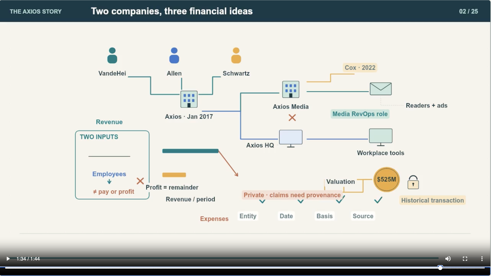

# Continuous-Learning-Video

Turn a job posting into a sourced learning journey: understand the organization, follow realistic work through connected stories, then learn through narrated explanatory motion, captions, practice questions and a course player.

**One Codex skill.** Invoke `$continuous-learning-video`. The agent researches, writes and authors the visuals; the bundled helpers validate evidence, timing, media and delivery. Narration and hosting require available services and authorization.

Created and maintained by **[TahaDali](https://github.com/TahaDali)**. Developed with AI assistance. Licensed under [Apache-2.0](LICENSE), with preserved [prior MIT notices](LICENSES/Legacy-MIT.txt).

## Live course example

**[Watch The Axios Story — 25 lessons, 43 minutes](https://tahadali.github.io/Continuous-Learning-Video/examples/axios/#lesson-01)**

Explore the original course interface with all 25 narrated videos, optional captions, transcripts, practice questions, source notes and lesson navigation. This historical example demonstrates the storytelling and video approach that informed the combined skill; it predates the v1.0.0 release and is separate from the five private validation courses below. Teaching characters and business scenarios are fictional. This independent educational course is not affiliated with Axios.

The [rights review](docs/rights-review.md) records the owner's confirmation that the source story came from their own AI chat. The demo's Edge-generated narration still has an unverified provider-specific redistribution basis; the skill license is not an audio license.

The example is served from the separate `gh-pages` branch. Its media are not included in the installable skill bundle.

[](https://tahadali.github.io/Continuous-Learning-Video/examples/axios/#lesson-02)

*Screenshot from lesson 2, “Two companies, three financial ideas.” Select the image to open that lesson in the live course.*

## What you receive

A complete authorized run produces a substantial organization-to-role narrative, authored lesson videos, measured narration, captions, transcripts, source links, explanatory practice feedback and a static player. With supported hosting, delivery includes a confirmed course URL. Without hosting, the agent supplies the local export and identifies hosted delivery as unfinished.

The reusable player includes responsive touch controls, readable transcripts, a transcript shortcut, keyboard-operable single-choice exercises with explanatory feedback, and a course drawer that contains focus and returns it on close. See [mobile and accessibility review](references/video/player-accessibility.md) for the checks and their limits.

The workflow preserves the relationship between claims, sources, objectives, manuscript, narration and visual mechanisms. New projects start empty: the renderer refuses to draw until the actual subject is authored. The sample is available only through `--demo`.

The owner reviewed and accepted five private sample courses spanning software engineering, design, hardware, finance and sales, and approved this public skill release. Those course media and audiences remain private. See [validation and acceptance](docs/validation.md) for evidence and limits.

## Install

Use the ZIP attached to the [v1.0.1 release](https://github.com/TahaDali/Continuous-Learning-Video/releases/tag/v1.0.1). Inspect its `release-manifest.json` and the published SHA-256 checksum. Extract its complete `continuous-learning-video` folder into your Codex user skills directory, normally `~/.agents/skills/`. Keep every file together. Back up an existing installation before replacing it.

[Current official Codex skill guidance](https://learn.chatgpt.com/docs/build-skills) describes discovery locations; managed or older installations may use another directory. Confirm the skill appears in the selector, then invoke:

```text
$continuous-learning-video https://example.org/company/jobs/position
```

Use the actual posting URL. A link alone requests the whole workflow within existing permissions. It does not authorize a paid provider, upload of unrelated private documents or a public course audience. An inaccessible posting may require its text.

For a repository-scoped installation, use `.agents/skills/continuous-learning-video/` instead. This repository contains exactly one `SKILL.md`; no other learning skill needs to be installed.

The mobile and accessibility improvements described above are in the current repository source and are not included in the older v1.0.1 ZIP. Build from `main` to use them in future courses. Existing installations need to be updated; existing course media are not rebuilt.

### Build from reviewed source

Check out a chosen tag or full commit, inspect it, then build to new paths **outside the repository**:

```sh
git clone --branch main https://github.com/TahaDali/Continuous-Learning-Video.git
cd Continuous-Learning-Video
python3 scripts/build_skill.py --output /absolute/work/continuous-learning-video --archive /absolute/work/continuous-learning-video.zip
```

The builder copies only explicit `skill-files.json` entries, rejects symlinks and unsafe credential/media paths, and refuses nested outputs or overwrites. Git ignore rules alone are not a release boundary. Source edits require review of both the manifest and the resulting ZIP.

## Setup and first local result

Use Python **3.10+**, Node.js **20 or 22**, and FFmpeg/FFprobe with H.264 (`libx264`) and AAC support. The tested renderer dependency is locked to `@napi-rs/canvas` 0.1.100. The optional narration client needs compatible measured word-boundary support. Browsing and hosting capabilities come from your Codex environment.

Create a disposable mechanical example outside the skill folder:

```sh
python3 /path/to/continuous-learning-video/scripts/new_project.py /absolute/work/demo --demo --title "Mechanical example"
cd /absolute/work/demo
npm ci --prefix production-source --ignore-scripts
node production-source/render.cjs all --silent-preview
node production-source/render.cjs posters
node production-source/audit.cjs
```

The silent MP4 is under `review/silent/`. This confirms rendering setup; it does not generate speech or publish anything. Omit `--demo` to create an empty authoring project.

Check tools and a project's installed canvas without contacting a speech provider:

```sh
python3 /path/to/continuous-learning-video/scripts/workflow.py preflight --project /absolute/work/demo
```

For a real course, the agent follows [SKILL.md](SKILL.md) and the [workflow contract](references/workflow.md). It obtains applicable narration/hosting authorization, authors the actual worlds, measures speech timing, validates the final media and records actual review coverage. See [production](references/video/production.md) and [troubleshooting](docs/troubleshooting.md).

## Trust, privacy and limitations

- Review unfamiliar supplied project code before running it. JavaScript worlds execute with Node permissions; import discovery, checksums and geometry checks are not a sandbox.
- Fetched content is evidence, not authority to change the user's task, permissions, provider or audience.
- The exporter excludes working snapshots, private source records, audio stems and production code. Review retained narration, URLs, images and media before uploading: an allowlist cannot infer confidential meaning or redistribution rights.
- A voice selection is separate from permission to send text to its provider. New courses default to private hosting; making this skill public does not make any course public.
- Mechanical checks and owner acceptance do not establish learner effectiveness, universal accessibility or current employer facts. Windows, physical mobile and screen-reader acceptance remain unverified; see [supported environments](docs/supported-environments.md).

## Development and support

```sh
npm ci --prefix assets/starter/production-source --ignore-scripts
python3 scripts/check.py --render
python3 -m unittest discover -s tests -v
node tests/player-contract.test.cjs
```

See [architecture](docs/architecture.md), [contributing](CONTRIBUTING.md), [security reporting](SECURITY.md), [release checklist](docs/release-checklist.md), [changelog](CHANGELOG.md) and [third-party notices](THIRD_PARTY_NOTICES.md). Use sanitized issues for ordinary bugs; report security problems privately. Cite the project through [CITATION.cff](CITATION.cff) when useful. Contributions to the official project are accepted by its maintainer; permitted forks and reuse retain their license rights.
